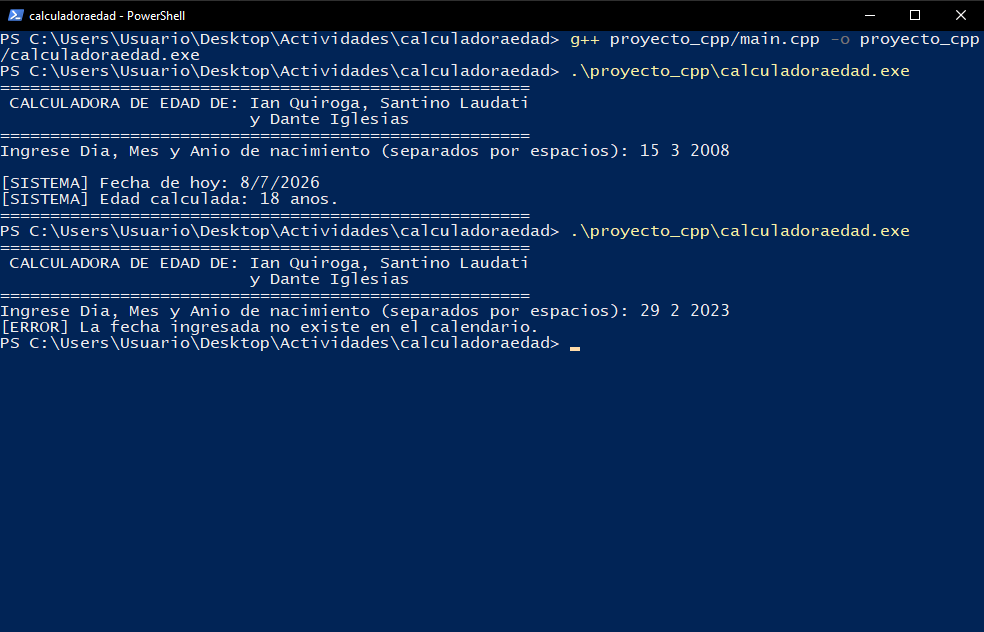

# 1. Propósito del documento

Este manual describe la arquitectura interna, las funciones, los requisitos de compilación y las pautas de mantenimiento de la **Calculadora de Edad**, desarrollada en dos versiones equivalentes: C++ (`proyecto_cpp/main.cpp`) y Python (`proyecto_python/main.py`). Está dirigido a cualquier programador que necesite leer, modificar o ampliar el código.

# 2. Requisitos del entorno

| Herramienta | Versión utilizada | Uso |
|---|---|---|
| Windows 10/11 | 10 LTSC 2021 | Sistema operativo |
| MSYS2 UCRT64 – g++ | 16.1.0 | Compilador de C++ |
| Python | 3.14.5 | Intérprete de Python |
| Visual Studio Code | Extensiones C/C++ y Code Runner | Editor / IDE |
| Git | 2.55 | Control de versiones |

> El compilador debe estar en el PATH (`C:\msys64\ucrt64\bin`). Si las PCs del laboratorio no lo permiten, el código puede ejecutarse en OnlineGDB.

# 3. Estructura del repositorio

```
calculadoraedad/
├── .gitignore  ├── LICENSE  ├── README.md
├── capturas/               evidencias .png
├── docs/                   informe APA + manuales
├── proyecto_cpp/main.cpp   versión C++
└── proyecto_python/main.py versión Python
```

# 4. Arquitectura y flujo del programa

El programa sigue un flujo lineal: **entrada → validación → cálculo → salida**.

1. Se muestra el encabezado con los nombres del grupo.
2. Se leen día, mes y año de nacimiento.
3. Si la lectura falla (letras), se informa el error y se termina con código 1.
4. `esFechaValida()` aplica el filtro de consistencia; si la fecha no existe se termina con código 1.
5. Se calcula la edad y se ajusta si todavía no se cumplieron años.
6. Si la edad da negativa (fecha futura) se informa el error.
7. Se muestran la fecha actual del ejercicio y la edad.

# 5. Referencia de funciones

## 5.1 `bool esBisiesto(int anio)` / `es_bisiesto(anio)`

| Parámetro | Tipo | Descripción |
|---|---|---|
| `anio` | `int` | Año a evaluar |
| **Retorno** | `bool` | `true` si es bisiesto |

Fórmula: `(anio % 4 == 0 && anio % 100 != 0) || (anio % 400 == 0)`.

## 5.2 `bool esFechaValida(int d, int m, int a)` / `es_fecha_valida(d, m, a)`

Devuelve `false` cuando:

- el año está fuera de 1900–2026;
- el mes no está entre 1 y 12;
- el día no está entre 1 y 31;
- el mes es 4, 6, 9 u 11 y el día es 31;
- el mes es 2 y el día supera 28 (o 29 si el año es bisiesto).

## 5.3 Bloque principal (`main`)

Variables principales:

| Variable | Tipo | Significado |
|---|---|---|
| `diaN, mesN, anioN` | `int` | Fecha de nacimiento ingresada |
| `diaA, mesA, anioA` | `int` | Fecha actual del ejercicio (8/7/2026) |
| `edad` | `int` | Resultado calculado |

```cpp
int edad = anioA - anioN;
if (mesA < mesN || (mesA == mesN && diaA < diaN))
    edad--;
```

# 6. Compilación y ejecución

```powershell
# C++ (desde la raíz del proyecto)
g++ proyecto_cpp/main.cpp -o proyecto_cpp/calculadoraedad.exe
.\proyecto_cpp\calculadoraedad.exe

# Python
python proyecto_python/main.py
```

Códigos de salida de la versión C++: `0` = ejecución correcta, `1` = dato inválido.

# 7. Pruebas

| Entrada | Esperado | Estado |
|---|---|---|
| 15 3 2008 | 18 años | OK |
| 9 7 2008 | 17 años | OK |
| 29 2 2024 | 2 años | OK |
| 29 2 2023 | Error de fecha | OK |
| 31 4 2000 | Error de fecha | OK |
| abc | Error de dato | OK |



# 8. Guía de mantenimiento

- **Cambiar la fecha actual:** modificar `diaA, mesA, anioA` en ambos archivos (o leer la fecha del sistema con `<ctime>` / `datetime.date.today()`).
- **Ampliar el rango de años:** editar la primera condición de `esFechaValida()`; si se usa la fecha del sistema, el límite superior debe ser el año actual.
- **Mantener ambas versiones sincronizadas:** todo cambio de lógica debe aplicarse en C++ y en Python.
- **Convenciones:** nombres en camelCase en C++ y snake_case en Python; comentarios en español; sin tildes en los textos de consola para evitar problemas de codificación en la terminal de Windows.
